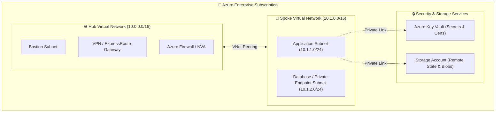

# 🔷 Production-Ready Azure Infrastructure using Reusable Terraform Modules

[](https://www.terraform.io/)
[](https://azure.microsoft.com/)
[](https://github.com/bridgecrewio/checkov)
[](LICENSE)

---

## 📌 Overview

This repository provides an **enterprise-grade, production-ready Infrastructure as Code (IaC)** framework built on Microsoft Azure. It uses **modular architecture**, environment isolation (Dev / QA / Prod), dynamic resource iteration via `for_each` and nested maps, and secure remote backend state management.

### Key Capabilities
* 🏗️ **Reusable Root & Child Modules**: Modular design separating Network, Compute, Storage, and Security.
* 🌐 **Hub-and-Spoke Architecture**: Scalable network isolation with centralized security inspection.
* 🛡️ **DevSecOps Integration**: Pre-deployment validation with Checkov, tfsec, and TFLint.
* 🔒 **Zero-Trust Access**: Private Endpoints, Azure Key Vault secrets injection, and RBAC governance.
* 📦 **Multi-Environment Support**: Separate `.tfvars` workspaces for `dev`, `stage`, and `prod`.

---

## 🏛️ High-Level Architecture Diagram



---

## 📂 Repository Directory Structure

```text
terraform-azure-modules/
├── modules/
│   ├── networking/            # VNet, Subnets, NSGs, Route Tables
│   │   ├── main.tf
│   │   ├── variables.tf
│   │   └── outputs.tf
│   ├── compute/               # Virtual Machines, NICs, Public IPs
│   │   ├── main.tf
│   │   ├── variables.tf
│   │   └── outputs.tf
│   ├── storage/               # Secure Storage Accounts & Containers
│   │   ├── main.tf
│   │   ├── variables.tf
│   │   └── outputs.tf
│   └── security/              # Azure Key Vault, RBAC, Managed Identities
│       ├── main.tf
│       ├── variables.tf
│       └── outputs.tf
├── environments/
│   ├── dev/
│   │   ├── terraform.tfvars
│   │   └── backend.tf
│   ├── stage/
│   │   ├── terraform.tfvars
│   │   └── backend.tf
│   └── prod/
│       ├── terraform.tfvars
│       └── backend.tf
├── main.tf                    # Root orchestration configuration
├── variables.tf               # Global input variables
├── outputs.tf                 # Global outputs
├── providers.tf               # AzureRM & Terraform provider configuration
└── README.md                  # Comprehensive Documentation
```

---

## 🚀 Deployment Guide

### Prerequisites
1. **Terraform CLI** `>= 1.5.0` installed.
2. **Azure CLI** installed and authenticated (`az login`).
3. An active **Azure Subscription** with `Contributor` or `Owner` role.
4. Azure Storage Account configured for **Remote State & Lease Locking**.

### Step 1: Clone Repository
```bash
git clone https://github.com/Irshad50/terraform-azure-modules.git
cd terraform-azure-modules
```

### Step 2: Initialize Terraform Backend
```bash
terraform init -backend-config="environments/dev/backend.tf"
```

### Step 3: Linting & Security Verification
```bash
# Validate syntax
terraform validate

# Lint check
tflint

# Static security analysis
checkov -d .
```

### Step 4: Plan Infrastructure Changes
```bash
terraform plan -var-file="environments/dev/terraform.tfvars" -out=tfplan
```

### Step 5: Apply Configuration
```bash
terraform apply tfplan
```

---

## 🛡️ DevSecOps & Security Best Practices Implemented

* **Encryption at Rest & in Transit**: TLS 1.2+ enforced on all storage accounts and private resources.
* **No Plaintext Secrets**: Zero credentials committed to version control; all secrets pulled dynamically from **Azure Key Vault**.
* **State File Security**: Remote backend in Azure Blob Storage with customer-managed keys (CMK) and HTTPS-only access.
* **Network Isolation**: All backend components reside in isolated subnets behind Network Security Groups (NSGs).

---

## 👨‍💻 Author

**Md Irshad Alam**  
*Lead Azure DevOps Engineer | Multi-Cloud Platform Architect*  
* 📬 **Email:** `mdirshadalam91190@gmail.com`  
* 💼 **LinkedIn:** [linkedin.com/in/md-irshad-alam-0a5278220](https://www.linkedin.com/in/md-irshad-alam-0a5278220)  
* 💼 GitHub: [@Irshad50](https://github.com/Irshad50)  
